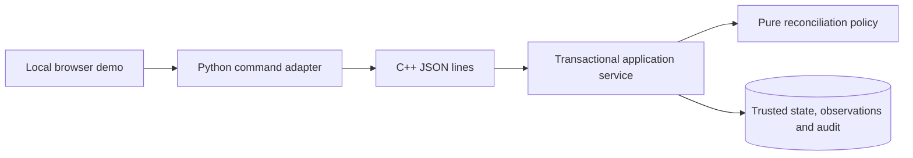
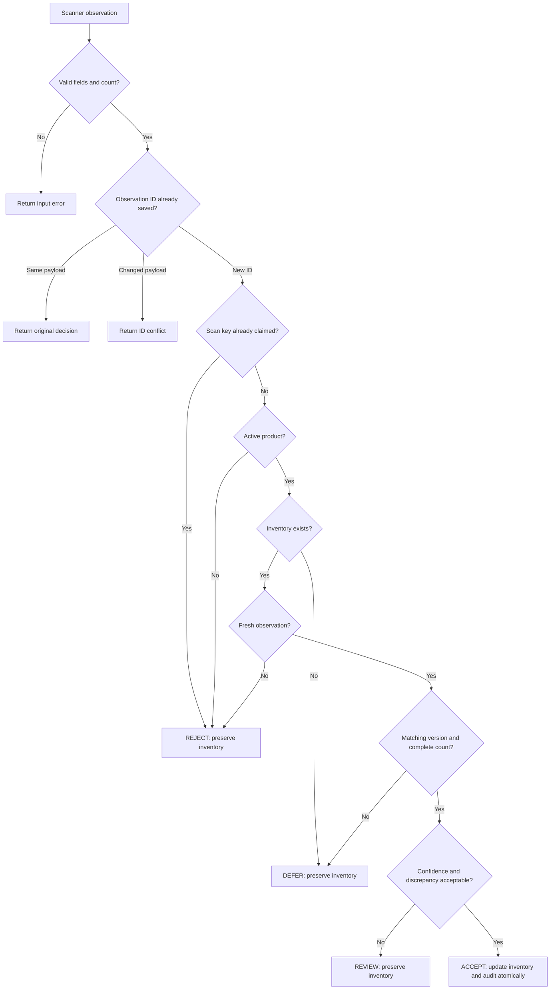

# StockGuard

A C++20 inventory reconciliation engine that keeps uncertain scanner counts separate from
trusted inventory. It produces explainable ACCEPT, REVIEW, REJECT and DEFER decisions,
commits verified changes with their audit records, and safely replays duplicate events.

This independent project uses synthetic data. It is not affiliated with Starbucks or deployed
in a store. The owner's cited Reuters discontinuation report remains unverified; see
[research and source boundaries](docs/research.md). The implemented problem stands on its
own: a model observation should not silently become an authoritative inventory fact.

## What works

- Product catalog creation, updates and queries; units cannot change after inventory exists.
- Versioned product-location inventory and signed trusted movements.
- Complete-count validation with coverage, freshness, version, confidence and discrepancy rules.
- Durable observation IDs, conflicting-payload rejection and alternate-ID scan replay protection.
- Partial batches with independent results and transactions.
- Human confirmation and correction with optimistic version checks; rejection without ledger changes.
- Immutable original decisions, pending review queries, review history and transactional audit.
- SQLite WAL, FULL synchronous, foreign keys, schema versioning and RAII rollback.
- Local browser demo with scenario buttons, review forms, ledger and benchmark results.
- 33 GoogleTests, fault injection, process-death recovery and concurrent submission tests.



The engine is a library independent of the interface. The Python adapter only transports
requests to one C++ executable. SQLite serializes writers across connections and processes.
A scan carries the version it observed; recorded stock movements advance that version.
Uncertain decisions leave trusted quantities unchanged. Human approval represents a fresh
complete count, rather than an unverified endorsement of an old scan.

## How a scan becomes a decision



REVIEW and DEFER enter the pending queue. A reviewer can reject the evidence without
changing inventory, or confirm/correct after a fresh complete count with a matching ledger
version. Original decisions remain immutable, and repeated requests do not duplicate updates.

## Why concurrent changes stay safe

```mermaid
sequenceDiagram
    participant Scanner
    participant Service as C++ service
    participant DB as SQLite
    Scanner->>Service: Count based on inventory version 1
    Service->>DB: BEGIN IMMEDIATE
    Service->>DB: Read current inventory and check replay
    DB-->>Service: Current version 2 after a stock movement
    Service->>DB: Save DEFER decision; preserve quantity
    Service->>DB: COMMIT
    Service-->>Scanner: Version conflict with explanation
    Note over Service,DB: ACCEPT writes quantity, version, decision and audit in one transaction
```

The version check prevents a scan from overwriting a newer stock movement. A failure before
commit rolls back the transaction. Once committed, replay returns the saved decision.

## Build

Linux and WSL2 are the intended platforms. Require GCC 12+ or a compatible C++20 compiler,
CMake 3.20+, Ninja, Python 3 and HTTPS access to dependency archives. Default builds compile
checksum-pinned SQLite 3.54.0, including the upstream WAL-reset corruption fix. JSON 3.11.3
and GoogleTest 1.16.0 are pinned by commit and checksum. See [dependencies](THIRD_PARTY.md).

On Ubuntu/WSL2, install build tools if absent:

```sh
sudo apt-get update
sudo apt-get install -y g++ cmake ninja-build python3 python3-venv curl
```

From the repository root:

```sh
cmake -S . -B build -G Ninja -DCMAKE_BUILD_TYPE=Debug
cmake --build build -j 2
ctest --test-dir build --output-on-failure
python3 scripts/smoke.py
```

The restricted cloud workspace uses `bash scripts/bootstrap-cloud.sh`, which installs pinned
user-local tooling and executes the same build and tests. Future cloud tasks should use the
existing checkout; no extra Git worktree is needed. Initial downloads need sqlite.org,
codeload.github.com, pypi.org and files.pythonhosted.org. Dependencies remain in ignored
build directories. A system SQLite override is optional and requires version 3.51.3+:
`-DSTOCKGUARD_SYSTEM_SQLITE=ON`.

## Run the demonstration

```sh
scripts/start-demo.sh
```

The demo listens on loopback port 8080 and persists local state in `.runtime/demo.db`.
The starter verifies backend health and can be repeated without replacing existing data.
It initializes only an absent demo product and inventory. Use the local browser on your
WSL/development machine. Cloud onboarding validates it with internal requests; no cloud
web preview is provided.

[Walkthrough and actual dashboard screenshot](docs/demo.md). The interface displays current
versions so a stale review can be detected rather than overwrite a concurrent movement.
The demo uses synthetic actors, without production authentication or authorization.

## Command example

This runnable example uses a new database and the actual current time:

```sh
mkdir -p .runtime
python3 - <<'PY' | build/stockguard --db .runtime/example.db
import json, time
requests = [
    dict(op='product_put', id='milk', name='Whole milk', category='dairy',
         unit='carton', status='active'),
    dict(op='initialize', product_id='milk', location_id='store', quantity=100, actor='seed'),
    dict(op='ingest', observation=dict(id='scan-1', scan_id='batch-1', product_id='milk',
         location_id='store', quantity=101, confidence=0.99, complete=True,
         expected_version=1, observed_at=int(time.time()), source='synthetic')),
    dict(op='inventory'),
    dict(op='audit'),
]
for request in requests:
    print(json.dumps(request))
PY
```

Expect ACCEPT, quantity 101, version 2 and two audit rows. Initialization refuses to overwrite
an existing record, so use a fresh database path to repeat this example. Replaying the same
observation returns the original decision without an extra inventory change. Full request
schemas, pagination, errors and partial batch semantics are in [API documentation](docs/api.md).
A custom policy can be supplied with `--policy config/policy.json`.

## Evidence and measurements

The final local Debug and Release builds pass all 33 GoogleTests. ASan/UBSan passes the same suite.
Four concurrency tests pass under TSan with one documented upstream SQLite WAL-header
suppression for GCC; see [ADR 002](docs/decisions/002-sqlite-sanitizers.md). Formatting and
selected clang-tidy analyzers pass. HTTP and real Chromium browser smoke checks pass.
Hosted GitHub Actions are prepared, but have not run remotely.

[Measured benchmarks](docs/benchmarks.md) compare blind acceptance, verify-everything,
confidence-only and StockGuard using labeled independent synthetic snapshots. On 10,000
snapshots, StockGuard gates 4,031 of 5,070 incorrect counts, while accepting 1,039 plausible
wrong counts and gating 991 correct ones. These are synthetic policy results, not evidence
of real-store accuracy. The 100,000-event durable-service benchmark preserves the final ledger
and verifies replays; raw throughput and latency reports include compiler and hardware data.
The timed database is on tmpfs, so those figures do not describe physical disk durability.

```sh
cmake -S . -B build-release -G Ninja -DCMAKE_BUILD_TYPE=Release -DBUILD_TESTING=OFF
cmake --build build-release -j 2
python3 scripts/run-benchmarks.py
```

Initial tmpfs runs cover up to 100,000 observations and four workers. A separate three-run
workspace-storage experiment measures 10,000 events per run and independently verifies the
closed database, observation totals and audit rows. The runner records storage type and
reports a throughput range and median. See the benchmark methodology for reproduction. A
million-event run is supported but unrun. No performance improvement or capacity guarantee
is inferred from these measurements. [Testing instructions](docs/testing.md) include
sanitizers, formatting, static analysis and the optional screenshot-producing browser test.

## Design tradeoffs and boundaries

The modular monolith favors explicit state and transaction boundaries over service infrastructure.
Queries also acquire BEGIN IMMEDIATE, which simplifies snapshots but limits concurrent reads.
There is no worker queue because SQLite is one writer and measured concurrency did not
justify queue lifecycle complexity. JSON evidence costs allocation and serialization time;
profiling is recorded before proposing statement caching or other optimization.

Physical count correctness, calibrated confidence, identity enforcement, backup automation,
distributed replication, fractional units and real store integrations are outside this release.
Audit durability does not mean tamper-proof storage. [Limits and roadmap](docs/limitations.md)
record these distinctions, the news verification gap and untested WSL/cloud restoration.

Read [architecture](docs/architecture.md), [data model](docs/data-model.md),
[decision rules](docs/reconciliation-design.md), [concurrency](docs/concurrency-design.md),
and [failure analysis](docs/failure-model.md) for the implemented guarantees.
[PROJECT_STATUS.md](PROJECT_STATUS.md) records verified progress and remaining work.
[Portfolio materials](docs/portfolio.md) contain a LinkedIn draft, resume bullets and interview
explanations. GitHub publication is authorized by the owner. LinkedIn publication and repository visibility
changes still require separate approval.

MIT licensed. Third-party notices and versions are in [THIRD_PARTY.md](THIRD_PARTY.md).
