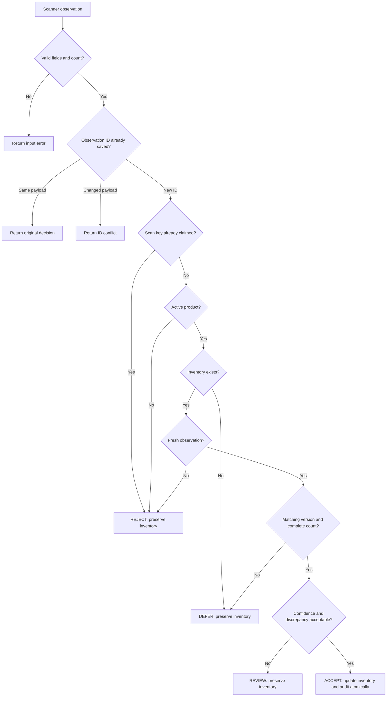
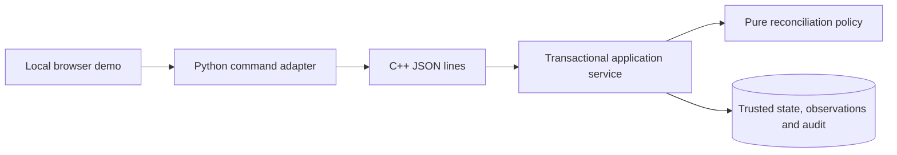

# StockGuard

StockGuard checks scanner counts before updating inventory. Uncertain counts go to human
review, and every inventory change has an audit record.

Built with **C++20 and SQLite**, with a local browser demo. Uses synthetic data.

## What happens to a scan?

| Decision | Meaning | Inventory changes? |
| --- | --- | --- |
| ACCEPT | The count passes all checks. | Yes, with an audit record. |
| REVIEW | Confidence is low or the count differs too much. | No. |
| DEFER | Inventory is missing, coverage is partial, or the version changed. | No. |
| REJECT | The scan is stale, duplicated, or uses an unknown/inactive product. | No. |

Malformed input returns an error. Repeating the same observation returns its saved result.



Reviewers can reject pending evidence, or confirm/correct it after a fresh count.
Confirmation and correction require the current inventory version.

## How it fits together



The C++ engine handles rules and storage. The Python adapter connects it to the browser.
Inventory updates, decisions and audit records commit together or roll back together.

## Try it locally

Use Linux or WSL2 with GCC 12+, CMake 3.20+, Ninja and Python 3.
Internet access is needed for pinned dependencies.

On Ubuntu/WSL2, install tools if needed:

```sh
sudo apt-get update
sudo apt-get install -y g++ cmake ninja-build python3 python3-venv curl
```

Build and test from the repository root:

```sh
cmake -S . -B build -G Ninja -DCMAKE_BUILD_TYPE=Debug
cmake --build build -j 2
ctest --test-dir build --output-on-failure
python3 scripts/smoke.py
scripts/start-demo.sh
```

On your local machine, open `http://127.0.0.1:8080`. Try a consistent count, a large
discrepancy, and a review action. Data stays in `.runtime/demo.db` between restarts.
The cloud workspace uses `bash scripts/bootstrap-cloud.sh`; no cloud preview is provided.

See the [demo walkthrough](docs/demo.md), [command example](docs/command-example.md),
and [API reference](docs/api.md).

## What if inventory changes during a scan?

```mermaid
sequenceDiagram
    participant Scanner
    participant Service as C++ service
    participant DB as SQLite
    Scanner->>Service: Count based on inventory version 1
    Service->>DB: BEGIN IMMEDIATE
    Service->>DB: Read current inventory and check replay
    DB-->>Service: Current version 2 after a stock movement
    Service->>DB: Save DEFER decision; preserve quantity
    Service->>DB: COMMIT
    Service-->>Scanner: Version conflict with explanation
    Note over Service,DB: ACCEPT writes quantity, version, decision and audit in one transaction
```

Version checks stop older scans from overwriting newer stock movements.

## Verified so far

- 33 tests pass in Debug, Release and ASan/UBSan.
- Four concurrency tests pass under TSan with a [documented SQLite suppression](docs/decisions/002-sqlite-sanitizers.md).
- HTTP, Chromium browser, formatting and static checks pass.
- [GitHub Actions](https://github.com/sunnyrishy/stockguard/actions) checks pushes and pull requests.

Synthetic benchmarks cover up to 100,000 events. The policy flagged 4,031 of 5,070
incorrect counts, but still accepted 1,039. This does not establish real-store accuracy.
Storage tests do not prove durability after physical power loss.
[Results and methodology](docs/benchmarks.md) explain the measurements.

## Limits and further reading

This is a local demonstration with no production authentication, automated backups or
real-store integration. It is independent of Starbucks; the cited Reuters claim remains
unverified. See [limitations](docs/limitations.md) and [research](docs/research.md).

- [Architecture](docs/architecture.md) and [data model](docs/data-model.md)
- [Decision rules](docs/reconciliation-design.md) and [concurrency](docs/concurrency-design.md)
- [Testing](docs/testing.md) and [failure analysis](docs/failure-model.md)
- [Project status](PROJECT_STATUS.md) and [portfolio drafts](docs/portfolio.md)

MIT licensed. [Dependency versions and notices](THIRD_PARTY.md).
