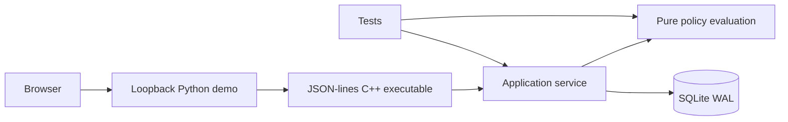
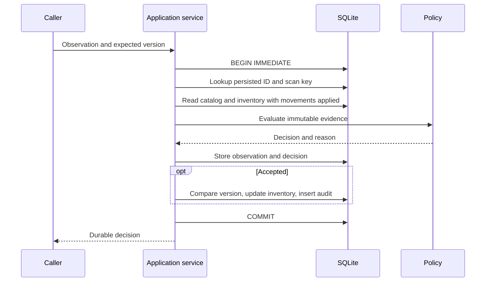

# Architecture
The C++ library owns policy evaluation and persistence. A JSON-lines executable provides
one integration boundary. The standard-library Python web demo invokes that executable
with a bounded input, timeout and fixed argument list. It contains no reconciliation logic.
Each process uses its own SQLite connection. SQLite serializes writers across processes.
There is no persistent worker pool: SQLite has one writer, and the bounded local HTTP
server uses a fixed concurrency limit. Batch ingestion is synchronous with per-item commits.

An event is received, validated, evaluated and committed as one transaction. REVIEW and
DEFER preserve trusted state. A human verification is a later transaction with a captured
version check. Query requests run in a consistent transaction too. RAII closes statements,
connections and unfinished transactions. Prepared statements bind all caller values.
