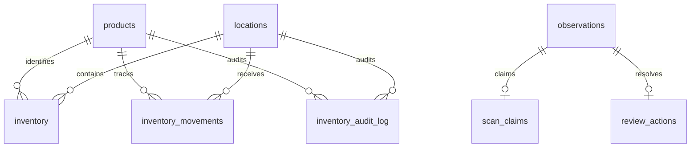

# Data model
Schema version 1 is created under BEGIN IMMEDIATE and recorded in PRAGMA user_version.
Newer schemas are refused. SQLite foreign keys are enabled on every connection. Quantities
are integer units from 0 through 1,000,000,000. Inventory version starts at 1 and increments
for every trusted operation, including verification that leaves quantity unchanged.
Identifiers are bounded ASCII strings. Metadata is a bounded JSON object.

Observations intentionally do not foreign-key their product or location IDs, because invalid
catalog references must be retained as explainable rejected decisions. Decisions and original
payloads are immutable JSON in the observation row; status is indexed for pending queries.
Scan claims are unique on scan ID, product and location. Review actions are unique per
observation. Movements have independent unique IDs. Audit rows are unique per product,
location and inventory version. Audit event_id is a logical reference with kind selecting
initialization, observation, review or movement. Audit and ledger writes share a transaction.
Location creation occurs during trusted initialization. There is no location catalog API.
Batch envelopes are transport correlation IDs, not durable idempotency keys; contained
observation and scan IDs supply durable replay semantics. Batch commits are partial by design.
