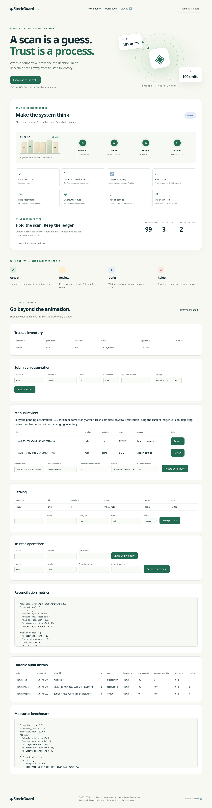

# Demonstration walkthrough

The [animated website guide](website.md) covers motion, mobile layout and standalone hosting.
Build and run `scripts/start-demo.sh`. The local interface uses the default milk/demo
inventory initialized only when absent. Inspect the trusted count and version.

1. Submit Consistent count. Expect ACCEPT and a new audit/version, even for an unchanged count.
2. Replay last scan. Expect replayed=true with no extra audit or version change.
3. Submit Uncertain classification. Expect REVIEW and unchanged trusted inventory.
4. Copy the pending observation ID and current version into Manual review. Select Correct count,
   enter a freshly verified count, and submit. Expect the queue to clear and an audit with actor.
5. Submit Partial scan, Stale observation and Unknown product. Expect DEFER or REJECT with reasons.
6. Record a signed movement with the current version. A scan against the old version cannot
   overwrite it. The concurrency test demonstrates competing submissions deterministically.
7. Inspect metrics and measured benchmark report. Large false-negative counts are deliberately
   included to avoid suggesting the system can prove observational truth.

The screenshot was captured by scripts/browser-smoke.cjs against a disposable synthetic
database. It shows executed actions, not fabricated interface state. The live demonstration
retains its separate database. Do not infer production authorization from synthetic actor IDs.
