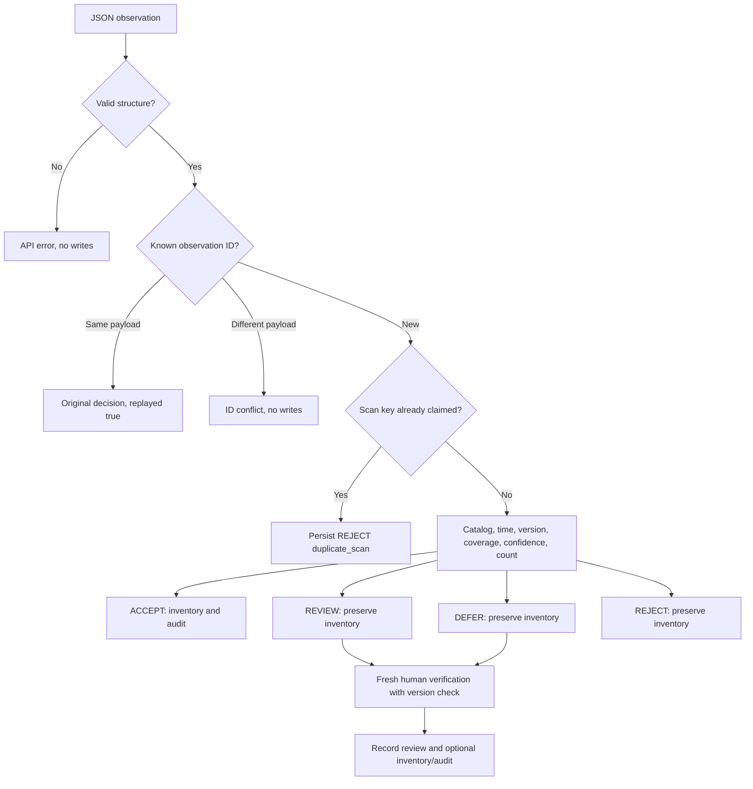

# Decision rules
Precedence is intentional: malformed input is an API error and is not persisted; durable
ID replay is checked before policy; an ID with a changed payload is a conflict. A scan key
(scan ID, product, location) belongs to one observation, preventing alternate-ID scan replay.
Unknown or inactive product is REJECT. Unknown inventory is DEFER. A scan outside the
freshness window or older than ledger time is REJECT. Excess future skew is REJECT.
Version mismatch or incomplete coverage is DEFER. Low confidence or discrepancy above
max(absolute tolerance, relative tolerance * expected quantity) is REVIEW. Otherwise ACCEPT.
Default confidence 0.95, absolute tolerance 2 units, relative tolerance 0.05, age 300 seconds,
future skew 5 seconds. Threshold boundaries are inclusive. These are demonstration policy
choices, not empirically calibrated business parameters.

The current ledger is the expected count because recorded movements update it atomically.
A scan based on a version before a movement cannot overwrite that movement. Any accepted
count creates an audit even if quantity is unchanged, since verification advances the version.
Evidence includes expected count, observed count, base version, observed version, timestamps,
confidence, coverage, discrepancy, policy and last update source. Deterministic evaluation
accepts an explicit clock value. Service callers cannot supply the server decision clock.

A human must perform a fresh complete verification, rather than approve an old scan blindly.
Review rejects negative corrections, stale verification and changed inventory versions.
An initial decision is immutable; a separate review action and audit preserve its history.
No rule can catch a confidently wrong small count that satisfies all constraints.

