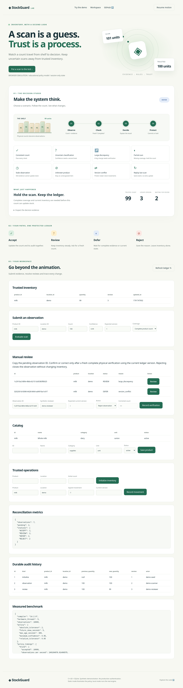

# Interactive website

**[Launch the website](https://sunnyrishy.github.io/stockguard/)**

The decision studio turns each scan into a visible journey: observe, check, decide, protect.
Moving cartons, a scan beam, a travelling token and count transitions explain the result.

## Try the walkthrough

1. Choose **Consistent count**. The version and audit advance together.
2. Choose **Replay last scan**. The saved result returns without an extra update.
3. Choose **Uncertain classification** or **Large discrepancy**. Inventory stays unchanged.
4. In Manual review, verify a fresh count and correct it, or reject the observation.
5. Try partial, stale, unknown-product and version-conflict scans. Watch the different paths.
6. Use **Pause motion** to stop animations. System reduced-motion settings are respected.

The workspace supports custom scans, catalog edits, initialization, signed movements,
reviews, inventory queries, metrics and audit history. Technical decision evidence is expandable.

## Two modes

| Mode | Engine | Storage |
| --- | --- | --- |
| Local dashboard | Real C++ engine | Persistent SQLite database |
| Standalone site | Educational JavaScript model | In-memory state; resets on reload |

The connection label identifies the mode. The standalone model illustrates the default
policy and common operations. It does not implement the full backend validation contract,
batches, crash recovery, SQLite concurrency or durable storage. Those guarantees are tested
in C++ and demonstrated through the local dashboard. Benchmark reports are recorded
measurements, not results generated by browser animations.

## Run or deploy

Real engine: build the project, then run `bash scripts/start-demo.sh`.
Standalone: `python3 scripts/build-site.py`, then serve `.runtime/site` with a static web server.

For GitHub Pages, open the repository's **Settings → Pages**, choose **GitHub Actions** as
Source, and run the **website** workflow from Actions if needed. It builds and deploys the
static files. The deployment job reports the actual website URL after success.

No production authentication or hosted C++ service is included. Actor names are synthetic.
